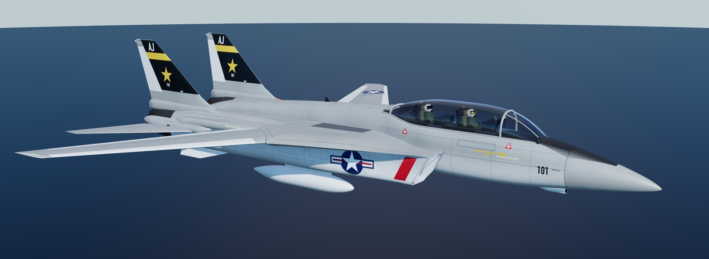
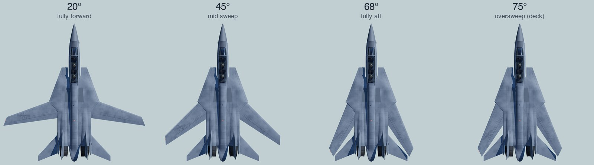

# F-14 Tomcat — Three.js

A realistic, fully procedural F-14 Tomcat built with [Three.js](https://threejs.org/), featuring **movable variable-sweep wings** and animated systems. Every part of the airframe is generated in code. The project uses no external 3D models or image textures.



## Variable-sweep wings



| Mode | Behaviour |
| --- | --- |
| **Auto (CADC)** | Follows a Central Air Data Computer–style schedule: 20° at low Mach, sweeping aft to 68° as Mach rises |
| **Manual** | Pilot-selected 20°–68°. The wings can't sweep forward of the auto schedule |
| **Bomb** | Fixed 55° |
| **Oversweep** | 75° deck-parking position. Like the real aircraft, it's only allowed with gear down and flaps up |

The wings sweep at a realistic rate, and the HUD planform diagram tracks them live.

## Features

- **Airframe:** blended fuselage and gloves, two-dimensional intakes, twin tails, stabilators, ventral fins, a twin-seat cockpit with crew, and a tandem bubble canopy
- **Moving parts:** wing sweep, flaps and slats (up / maneuver / full), landing gear, canopy, tail hook, speed brakes, stabilators, spoilers and rudders
- **Engines:** variable nozzles with throttle and afterburner glow
- **Liveries:** low-vis TPS grey, or 1970s gull grey / white with squadron markings
- **Scenes:** parked on an apron (chocks, markings) or in flight over the sea, with a dynamic sun, sky, clouds and shadows
- **HUD:** live readout of sweep, Mach, flaps, gear, hook and engine state, with interlock warnings

## Controls

| Key | Action |
| --- | --- |
| `[` / `]` | Sweep wings forward / aft (switches to manual) |
| `M` | Cycle sweep mode (auto → manual → bomb → oversweep) |
| `F` | Cycle flaps (up → maneuver → full) |
| `G` / `C` / `H` / `B` | Gear / canopy / hook / speed brakes |
| `A` | Afterburner |
| `↑` `↓` `←` `→` | Stick (stabilators, spoilers) |
| `Q` / `E` | Rudder |
| `L` | Lights |
| `R` | Auto-rotate camera |
| `1`–`7` | Camera views: three-quarter, front, side, top, rear, cockpit, glove close-up |
| Mouse | Drag to orbit, scroll to zoom |

The panel on the right gives full control: Mach slider, manual sweep, sweep demo, control-surface exerciser, paint scheme, drop tanks, crew, scene, sun position, exposure and shadows.

## Getting started

Requires **Node.js 20.19+ or 22.12+** and a WebGL 2 capable browser.

```bash
npm install
npm run dev       # http://localhost:5173
npm run build     # production build in dist/
npm run preview   # serve the production build
```

## Project structure

```
index.html            HUD / help overlay and page shell
src/main.js           scene, lighting, environments, GUI, keyboard, main loop
src/f14/
  F14.js              assembles the aircraft, state → animation, auto-sweep schedule
  dims.js             reference dimensions and sweep limits
  geom.js             design-frame helpers (station / buttline / waterline → Three.js)
  util.js             lofting and shape utilities
  body.js             fuselage, gloves, intakes
  wing.js             outer wing panels, flaps, slats, spoilers
  tail.js             fins, rudders, stabilators, ventrals
  engine.js           nozzles, afterburner
  gear.js             nose and main landing gear
  cockpit.js          cockpit interior, seats, crew, canopy
  livery.js           procedural paint schemes and markings (canvas textures)
  materials.js        PBR materials
```

For debugging in the browser console, `window.__f14` exposes the jet, scene, camera and helpers.

## How long it took

**GitHub Copilot CLI** (Claude Opus 5.5) wrote the whole project from a single prompt: *"create 3js model of realistic f14 tomcat with movable wings"*. It took about **2 hours** of wall-clock time (15:52 to 17:50 EST, 5 Nov 2026). These times come from the session's checkpoint and file timestamps.

| Phase | Time |
| --- | --- |
| Researching F-14 references and designing the geometry | ~25 min |
| Scaffolding the Vite project and finalising the geometry plan | ~24 min |
| Writing the geometry modules (body, wing, tail, engine, gear, cockpit) | ~19 min |
| Liveries, materials and aircraft assembly | ~16 min |
| Getting the app running, reworking lighting, visual fixes | ~16 min |
| Polish and verification: clearance checks, screenshot review, interaction tests, production build | ~18 min |

The result is about 4,100 lines of JavaScript.

## Notes

This is a visual model, not a flight simulator. Dimensions and sweep limits follow published F-14 figures. Some details are simplified for real-time rendering.
